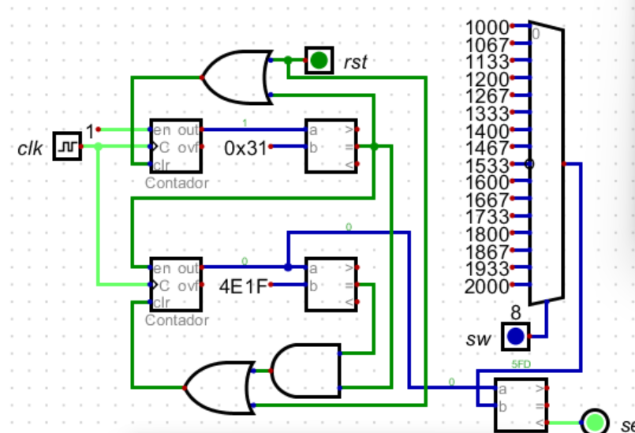
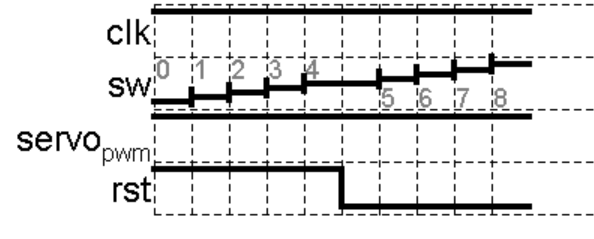
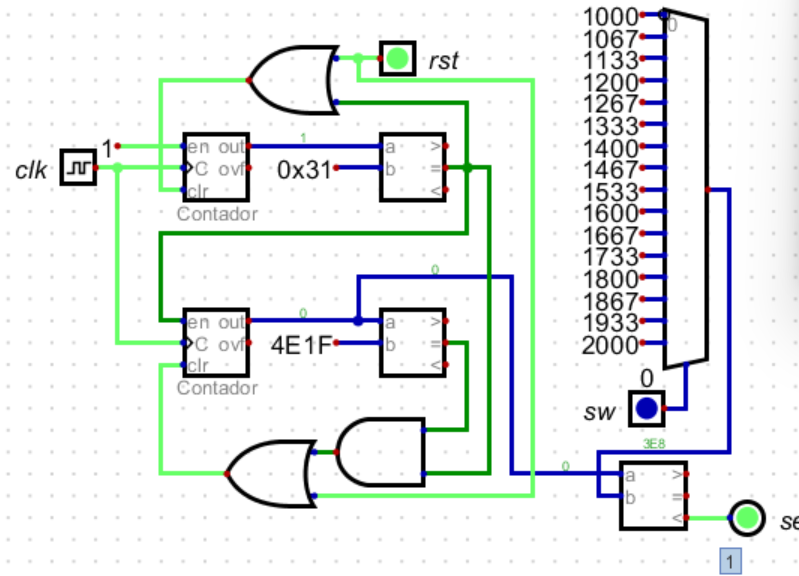
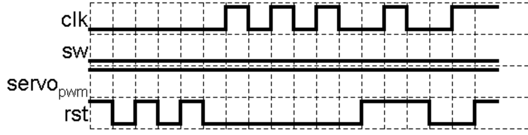
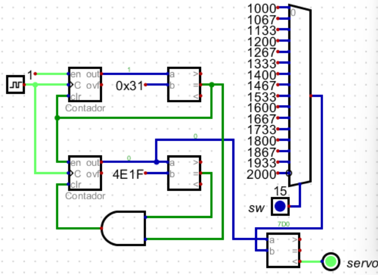
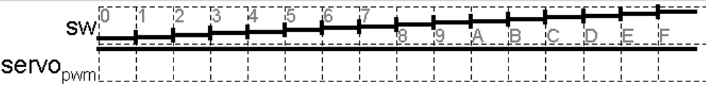

# Generador PWM para servomotor

Módulo en Verilog que genera la señal PWM para controlar la posición de un servomotor desde 4 switches. Forma parte del proyecto FPGA_PONG.


## Funcionamiento

- **Periodo:** 20 ms (50 Hz).
- **Ancho de pulso:** de `PULSO_MIN_US` (0°) a `PULSO_MAX_US` (180°). Por defecto, 0.5 ms a 2.5 ms.
- **Entrada `A[3:0]`:** 16 posiciones, de `0000` (0°) a `1111` (180°), en pasos de 12°.
- **El ancho de pulso se actualiza al inicio de cada periodo,** así que cambiar los switches nunca produce un pulso cortado.
- **Las entradas y el reset se sincronizan con 2 flip-flops** para evitar metaestabilidad.

## Puertos

| Puerto  | Dirección | Descripción                                    |
|---------|-----------|------------------------------------------------|
| `clk`   | entrada   | Reloj de la placa (50 MHz por defecto)         |
| `rst`   | entrada   | Reset: reinicia el contador y pone la salida en 0 |
| `A[3:0]`| entrada   | Posición deseada del servo                     |
| `pulso` | salida    | Señal PWM hacia el cable de señal del servo    |

## Parámetros

| Parámetro               | Por defecto  | Descripción                                          |
|-------------------------|--------------|------------------------------------------------------|
| `CLK_HZ`                | 50_000_000   | Frecuencia del reloj de la placa                     |
| `CAMBIO_HZ`             | 50           | Frecuencia del PWM (periodo de 20 ms)                |
| `ENTRADAS_ACTIVAS_BAJO` | 1            | 1 si los switches dan 0 lógico cuando están activos  |
| `RESET_ACTIVO_BAJO`     | 1            | 1 si el reset se activa con 0 (botón con pull-up)    |
| `PULSO_MIN_US`          | 500          | Ancho de pulso para 0°, en µs                        |
| `PULSO_MAX_US`          | 2500         | Ancho de pulso para 180°, en µs                      |

## Archivos

- `top_pwm_generator.v`: módulo principal y codificador de 4 bits a ciclos de reloj.
- `tb_top_pwm_generator.v`: testbench que mide el periodo y el ancho de pulso de las 16 posiciones y prueba el reset.

## Simulación

Con Icarus Verilog y GTKWave:

```
iverilog -o sim tb_top_pwm_generator.v top_pwm_generator.v
vvp sim
gtkwave pwm.vcd
```

La simulación tarda cerca de un minuto y termina con `RESULTADO: TODAS LAS PRUEBAS PASARON`.

## Conexión del servo

- **Alimentación:** usa una fuente externa de 4.8–6 V, no el pin de 5 V de la FPGA.
- **Tierra común:** une la GND de la fuente con la GND de la FPGA.
- **Señal:** conecta `pulso` al cable de señal del servo. La salida de 3.3 V de la FPGA funciona con la mayoría de los servos.

## Calibración

Si el servo no llega a los extremos, amplía `PULSO_MIN_US` o `PULSO_MAX_US`. Si zumba o se fuerza en un extremo, está chocando con su tope mecánico: reduce el rango, por ejemplo a 600–2400 µs.


## CÁLCULOS
## Cálculo del período del reloj principal

La FPGA utiliza una señal de reloj con una frecuencia de:

$$
f_{clk}=50\,000\,000\ \text{Hz}
$$

El período de esta señal se determina mediante:

$$
T_{clk}=\frac{1}{f_{clk}}
$$

Sustituyendo:

$$
T_{clk}=\frac{1}{50\,000\,000}
$$

$$
\boxed{T_{clk}=20\ \text{ns}}
$$

Esto significa que el reloj principal produce un ciclo cada 20 nanosegundos.

Por tanto, en un segundo se generan 50 millones de ciclos de reloj.

### Cantidad de ciclos para un período PWM

El servomotor se controla mediante una señal periódica de 50 Hz.

El período se calcula como:

$$
T_{PWM}=\frac{1}{f_{PWM}}
$$

$$
T_{PWM}=\frac{1}{50}
$$

$$
\boxed{T_{PWM}=20\ \text{ms}}
$$

Si se utiliza directamente el reloj de 50 MHz, el número de ciclos necesarios para completar un período PWM es:

$$
N_{PWM}=T_{PWM}\cdot f_{clk}
$$

$$
N_{PWM}=0.02\cdot50\,000\,000
$$

$$
\boxed{N_{PWM}=1\,000\,000\ \text{ciclos}}
$$

De esta manera, para generar una señal de 50 Hz directamente desde el reloj principal sería necesario contar un millón de ciclos.

### Cantidad de ciclos para los pulsos del servomotor

Para un pulso mínimo de 1 ms:

$$
N_{min}=0.001\cdot50\,000\,000
$$

$$
\boxed{N_{min}=50\,000}
$$

Para un pulso máximo de 2 ms:

$$
N_{max}=0.002\cdot50\,000\,000
$$

$$
\boxed{N_{max}=100\,000}
$$

Por tanto, utilizando directamente el reloj principal, el sistema debería generar pulsos de entre 50.000 y 100.000 ciclos, dentro de un período de un millón de ciclos.

Sin embargo, se decidió implementar una base de tiempo de 1 µs para simplificar el diseño de los contadores y las constantes empleadas en el circuito.

---

## Diseño del divisor de frecuencia

El propósito del divisor es generar un pulso de habilitación cada microsegundo, utilizando el reloj principal de 50 MHz.

Se estableció una frecuencia de actualización:

$$
f_{tick}=1\ \text{MHz}
$$

La relación de división necesaria es:

$$
N_{div}=\frac{f_{clk}}{f_{tick}}
$$

Sustituyendo:

$$
N_{div}=\frac{50\,000\,000}{1\,000\,000}
$$

$$
\boxed{N_{div}=50}
$$

Esto significa que por cada 50 ciclos del reloj principal se debe producir un pulso de habilitación.

### Tiempo generado por el divisor

Como cada ciclo dura 20 ns:

$$
T_{tick}=50\cdot20\ \text{ns}
$$

$$
\boxed{T_{tick}=1000\ \text{ns}=1\ \mu s}
$$

Por tanto, cada incremento del contador PWM representará exactamente un microsegundo.

### Número de bits del divisor

Para determinar el número mínimo de bits del contador se utiliza:

$$
2^n\geq N
$$

O, de manera equivalente:

$$
n=\lceil\log_2(N)\rceil
$$

Para 50 estados:

$$
n=\lceil\log_2(50)\rceil
$$

$$
n=\lceil5.644\rceil
$$

$$
\boxed{n=6\ \text{bits}}
$$

Un contador de 5 bits proporciona solamente 32 estados, mientras que uno de 6 bits proporciona 64.

En consecuencia, se utiliza un contador de 6 bits que recorre los valores:

$$
0,1,2,\ldots,49
$$

Cuando el contador llega a 49, se genera la condición de reinicio y se inicia nuevamente la secuencia desde cero.

El valor decimal 49 corresponde a:

```text
49 = 110001₂
```

La condición de fin de conteo es:

```verilog
contador_divisor == 6'b110001
```

La salida del divisor se utiliza como una señal de habilitación de un ciclo del reloj principal, denominada `tick`.

Es importante destacar que ambos contadores pueden funcionar con el mismo reloj de 50 MHz. El `tick` habilita el avance del contador PWM cada 50 ciclos, evitando generar una segunda señal de reloj física.

---

## Diseño del contador principal PWM

Una vez obtenida la base de tiempo de 1 µs, se determina la cantidad de incrementos necesarios para completar un período de 20 ms.

Se utiliza:

$$
N_{PWM}=\frac{T_{PWM}}{T_{tick}}
$$

Sustituyendo:

$$
N_{PWM}=\frac{20\,000\ \mu s}{1\ \mu s}
$$

$$
\boxed{N_{PWM}=20\,000}
$$

Esto significa que el contador principal debe recorrer 20.000 estados por cada período de la señal.

### Número de bits del contador

Se calcula:

$$
n=\lceil\log_2(20\,000)\rceil
$$

$$
n=\lceil14.288\rceil
$$

$$
\boxed{n=15\ \text{bits}}
$$

La elección se justifica porque:

$$
2^{14}=16\,384
$$

$$
2^{15}=32\,768
$$

Un contador de 14 bits no puede representar los 20.000 estados requeridos. Por ello, se utiliza un contador de 15 bits.

### Condición de reinicio

El contador comienza en cero y aumenta una unidad cada vez que recibe un `tick`.

La secuencia es:

$$
0,1,2,\ldots,19\,999
$$

Al alcanzar el valor 19.999, se reinicia a cero en el siguiente incremento habilitado.

Se utiliza 19.999 como último valor porque el estado cero también hace parte de los 20.000 estados totales.

La representación binaria del valor de comparación es:

```text
19999 = 100111000011111₂
```

Por tanto, la condición de reinicio es:

```verilog
contador_pwm == 15'b100111000011111
```

### Verificación de la frecuencia

El tiempo de un período completo es:

$$
T=20\,000\cdot1\ \mu s
$$

$$
T=20\ \text{ms}
$$

Por consiguiente:

$$
f=\frac{1}{0.02}
$$

$$
\boxed{f=50\ \text{Hz}}
$$

Con esto se verifica que la combinación del divisor y del contador principal permite generar la frecuencia PWM establecida.

---

## Cálculo del ancho de pulso

En este proyecto se utiliza un intervalo de pulsos entre 1 ms y 2 ms.

Como la base de tiempo es de 1 µs, se obtiene:

Para 1 ms:

$$
N_{alto,min}=\frac{1000\ \mu s}{1\ \mu s}
$$

$$
\boxed{N_{alto,min}=1000}
$$

Para 2 ms:

$$
N_{alto,max}=\frac{2000\ \mu s}{1\ \mu s}
$$

$$
\boxed{N_{alto,max}=2000}
$$

Esto significa que la señal PWM debe permanecer en estado alto durante un número de incrementos comprendido entre 1000 y 2000.

El resto del período permanecerá en estado bajo.

### Ciclo de trabajo

El ciclo de trabajo se define como:

$$
D=\frac{T_{on}}{T_{PWM}}\cdot100\%
$$

Para el pulso mínimo:

$$
D_{min}=\frac{1}{20}\cdot100\%
$$

$$
\boxed{D_{min}=5\%}
$$

Para el pulso máximo:


```math
D_{\mathrm{max}}=\frac{2}{20}\cdot100\,\%
```

```math
\boxed{D_{\mathrm{max}}=10\,\%}
```


Por tanto, la señal PWM presenta un ciclo de trabajo variable entre el 5 % y el 10 %.

Aunque cambia el ciclo de trabajo, el período permanece constante en 20 ms.

---

## Cálculo de las 16 posiciones del servomotor

El circuito dispone de cuatro entradas binarias de selección:

```text
sw[3:0]
```

El número de combinaciones posibles es:

$$
N=2^4
$$

$$
\boxed{N=16}
$$

Estas combinaciones permiten seleccionar 16 valores diferentes de ancho de pulso.

La entrada mínima:

```text
0000
```

Corresponde a un pulso de 1 ms.

La entrada máxima:

```text
1111
```

Corresponde a un pulso de 2 ms.

### Incremento entre posiciones

El intervalo total de variación del pulso es:

$$
\Delta T=2000-1000
$$

$$
\Delta T=1000\ \mu s
$$

Como existen 16 posiciones, hay 15 intervalos entre ellas.

Por tanto:

$$
\Delta t=\frac{1000}{15}
$$

$$
\boxed{\Delta t\approx66.67\ \mu s}
$$

Esto indica que, por cada incremento en la entrada de selección, el ancho del pulso aumenta aproximadamente 66,67 µs.

### Ecuación general

Sea `pos` el valor decimal de las cuatro entradas de selección:

$$
pos\in\{0,1,2,\ldots,15\}
$$

El ancho del pulso se determina mediante:

$$
T_{on}=1000+\frac{1000}{15}\cdot pos
$$

Donde $T_{on}$ está expresado en microsegundos.

Como el circuito trabaja con una resolución de 1 µs, se utilizan los valores enteros más cercanos:

$$
\boxed{
N_{alto}=
\operatorname{round}
\left(1000+\frac{1000}{15}\cdot pos\right)
}
$$

La operación de redondeo se aplica al definir las constantes del circuito.

### Cálculos de posiciones particulares

**Posición 0:**

$$
T_{on}=1000+\frac{1000}{15}(0)
$$

$$
\boxed{T_{on}=1000\ \mu s}
$$

**Posición 7:**

$$
T_{on}=1000+\frac{1000}{15}(7)
$$

$$
T_{on}=1466.67\ \mu s
$$

$$
\boxed{T_{on}\approx1467\ \mu s}
$$

**Posición 15:**

$$
T_{on}=1000+\frac{1000}{15}(15)
$$

$$
\boxed{T_{on}=2000\ \mu s}
$$

De esta forma se obtiene un incremento aproximadamente uniforme entre las 16 posiciones.

---

## Tabla de posiciones y valores de comparación

Los resultados de la ecuación anterior se presentan en la siguiente tabla.

| Posición | Selección binaria | Pulso alto (µs) | Ciclo de trabajo (%) |
|---|---|---:|---:|
| 0 | 0000 | 1000 | 5.000 |
| 1 | 0001 | 1067 | 5.335 |
| 2 | 0010 | 1133 | 5.665 |
| 3 | 0011 | 1200 | 6.000 |
| 4 | 0100 | 1267 | 6.335 |
| 5 | 0101 | 1333 | 6.665 |
| 6 | 0110 | 1400 | 7.000 |
| 7 | 0111 | 1467 | 7.335 |
| 8 | 1000 | 1533 | 7.665 |
| 9 | 1001 | 1600 | 8.000 |
| 10 | 1010 | 1667 | 8.335 |
| 11 | 1011 | 1733 | 8.665 |
| 12 | 1100 | 1800 | 9.000 |
| 13 | 1101 | 1867 | 9.335 |
| 14 | 1110 | 1933 | 9.665 |
| 15 | 1111 | 2000 | 10.000 |

Los valores han sido aproximados al microsegundo más cercano, debido a la resolución temporal establecida.

Cada valor de la tercera columna también representa el número de incrementos durante los cuales la salida PWM debe permanecer en estado alto.

---

## Implementación mediante multiplexor de 16 entradas

Para seleccionar el ancho de pulso correspondiente a cada posición se utiliza un multiplexor de 16 entradas y una salida.

El multiplexor recibe 16 constantes, una para cada posición.

Las líneas de selección corresponden a los cuatro bits de entrada:

```text
sw[3:0]
```

El funcionamiento consiste en seleccionar una constante numérica en función de la combinación binaria ingresada.

Por ejemplo:

- `0000` selecciona 1000.
- `0001` selecciona 1067.
- `0111` selecciona 1467.
- `1000` selecciona 1533.
- `1111` selecciona 2000.

El multiplexor entrega el valor seleccionado a un comparador digital, encargado de determinar cuánto tiempo permanece activa la señal PWM.

### Representación binaria de las constantes

Debido a que el contador PWM utiliza 15 bits, los valores del multiplexor pueden representarse con el mismo ancho.

| Posición | Decimal | Binario de 15 bits |
|---|---:|---|
| 0 | 1000 | `000001111101000` |
| 1 | 1067 | `000010000101011` |
| 2 | 1133 | `000010001101101` |
| 3 | 1200 | `000010010110000` |
| 4 | 1267 | `000010011110011` |
| 5 | 1333 | `000010100110101` |
| 6 | 1400 | `000010101111000` |
| 7 | 1467 | `000010110111011` |
| 8 | 1533 | `000010111111101` |
| 9 | 1600 | `000011001000000` |
| 10 | 1667 | `000011010000011` |
| 11 | 1733 | `000011011000101` |
| 12 | 1800 | `000011100001000` |
| 13 | 1867 | `000011101001011` |
| 14 | 1933 | `000011110001101` |
| 15 | 2000 | `000011111010000` |

Las entradas del multiplexor se configuran con estas constantes binarias.

Así, no es necesario realizar operaciones de división o multiplicación dentro del circuito para calcular el ancho del pulso: los resultados se encuentran previamente definidos.

---


## Diseño del comparador PWM

La generación de la señal PWM se realiza comparando dos valores:

1. El valor actual del contador PWM.
2. El valor de referencia entregado por el multiplexor.

La condición lógica utilizada es:

$$
\boxed{\mathrm{PWM}=(\mathrm{contador}_{PWM}\lt\mathrm{referencia})}
$$

Esto significa que:

$$
\mathrm{PWM}=
\begin{cases}
1 & \text{si } \mathrm{contador}_{PWM}\lt\mathrm{referencia} \\
0 & \text{si } \mathrm{contador}_{PWM}\geq\mathrm{referencia}
\end{cases}
$$

Por tanto, el comparador genera un nivel lógico alto mientras el valor del contador sea inferior a la referencia seleccionada.

Cuando el contador alcanza o supera dicha referencia, la salida cambia a un nivel lógico bajo.

Este procedimiento permite modificar el ancho del pulso sin alterar el período total de la señal.

---

### Ejemplo para un pulso de 1 ms

Si la posición seleccionada corresponde al valor 1000:

```text
Referencia = 1000
```

Mientras el contador tenga valores comprendidos entre 0 y 999:

```text
PWM = 1
```

Al alcanzar el valor 1000:

```text
PWM = 0
```

Como cada incremento equivale a 1 µs, la salida permanece activa durante:

$$
T_{on}=1000\cdot1\ \mu s
$$

$$
\boxed{T_{on}=1\ \text{ms}}
$$

El tiempo restante del período corresponde al estado bajo de la señal:

$$
T_{off}=T_{PWM}-T_{on}
$$

Sustituyendo:

$$
T_{off}=20\ \text{ms}-1\ \text{ms}
$$

$$
\boxed{T_{off}=19\ \text{ms}}
$$

El ciclo de trabajo correspondiente es:

$$
D=\frac{T_{on}}{T_{PWM}}\cdot100\%
$$

$$
D=\frac{1}{20}\cdot100\%
$$

$$
\boxed{D=5\%}
$$

Por tanto, para esta selección se obtiene una señal PWM con las siguientes características:

| Parámetro | Valor |
|---|---|
| Período total | 20 ms |
| Frecuencia | 50 Hz |
| Tiempo en alto | 1 ms |
| Tiempo en bajo | 19 ms |
| Ciclo de trabajo | 5 % |

De esta manera, el comparador permite generar un pulso de 1 ms dentro de un período de 20 ms, manteniendo constante la frecuencia de operación.


## Simulaciones

### Simulación 1



### Simulación 2



### Simulación 3



