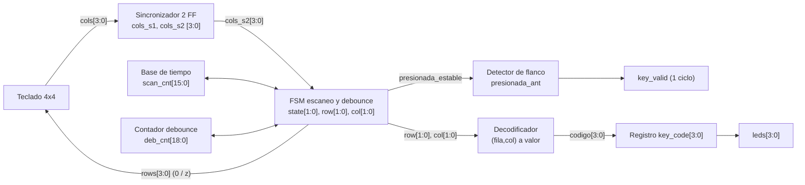
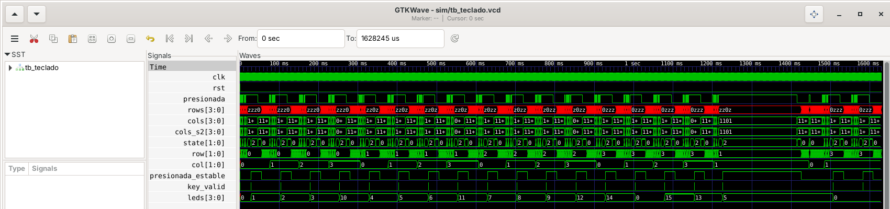
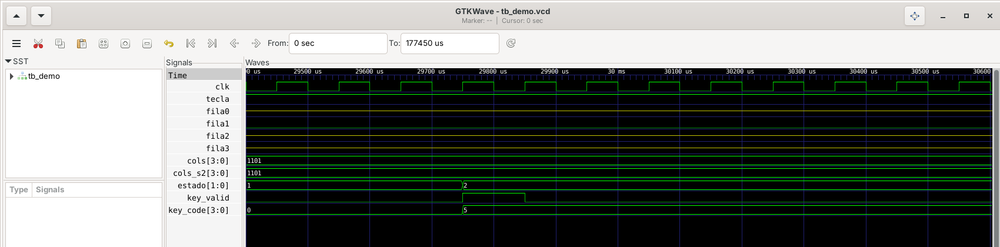

# Lab 4 – Parte 2: Teclado matricial 4×4 — Resumen del pre-informe

FPGA A-C4E6E10 (Cyclone IV E, reloj 50 MHz). Revisión rápida.

## 1. Diseño en una mirada

Un barrido activa **una fila a la vez** (activo en bajo; las demás en alta impedancia `1'bz`) y lee las columnas (con pull-up) a través de un **sincronizador de 2 flip-flops**.
Una **FSM de 4 estados** detiene el barrido al detectar una tecla, valida con **debounce** que la misma columna siga en 0 durante 10 ms y, al validar, carga `key_code`
y genera `key_valid` con un **detector de flanco** (un solo ciclo de reloj).

### Diagrama de bloques

### Descripción en HDL (rápida)

- **Sincronizador:** `cols_s1 <= cols; cols_s2 <= cols_s1;` evita metaestabilidad; solo se usa `cols_s2`.
- **Escaneo:** `scan_cnt` cuenta 1 ms por fila; al final del intervalo se lee `cols_s2`. `rows[i] = (row==i) ? 1'b0 : 1'bz`.
- **FSM:** `S_SCAN` (barre) → `S_DEB_PRESS` (la columna debe seguir en 0 por 10 ms; si sube, era rebote) → `S_PRESSED` (barrido detenido) → `S_DEB_REL` (columna en 1 por 10 ms) → `S_SCAN`.
- **Decodificador:** (fila, columna) → valor de la tecla (0–9, A–D = 10–13, `*` = 14, `#` = 15).
- **Detector de flanco:** `key_valid = presionada_estable & ~presionada_ant` → pulso de un ciclo por pulsación.
- **Top:** sincroniza el reset (botón K4, activo en bajo), invierte `key_code` para los LEDs activos en bajo y estira `key_valid` ≈100 ms para verlo en un LED.

### Parámetros usados y por qué

| Parámetro | Valor | Por qué |
|---|---|---|
| `CLK_FREQ` | 50 MHz (100 kHz en simulación) | Reloj de la tarjeta; en simulación se reduce para que corra rápido (mismo comportamiento). |
| `SCAN_MS` | 1 ms | Tiempo de sobra para que las columnas se estabilicen; barrido completo de 4 ms. |
| `DEBOUNCE_MS` | 10 ms | Mayor que el rebote típico (5–20 ms) y cumple el mínimo de la guía (≥ 10 ms). |
| `LED_ACTIVE_LOW` | 1 | Los LEDs de la tarjeta encienden con 0; así LED encendido = bit en 1. |

## 2. Cálculos

T_clk = 1 / 50 MHz = 20 ns, N = t · f_clk, b = ⌈log₂ N⌉

| Parámetro | Tiempo | Cuentas de reloj | Bits del contador | Verificación |
|---|---|---|---|---|
| Base de tiempo del escaneo (por fila) | 1 ms | 1 ms · 50 MHz = **50 000** | **16** | 2¹⁵ = 32 768 < N ≤ 2¹⁶ = 65 536 |
| Tiempo de debounce | ≥ 10 ms (10 ms) | 10 ms · 50 MHz = **500 000** | **19** | 2¹⁸ = 262 144 < N ≤ 2¹⁹ = 524 288 |

Derivados: barrido completo = 4 ms (250 Hz); latencia de `key_valid` entre 10 y ≈14 ms (hasta 4 ms de espera + 10 ms de debounce); sincronizador = 2 ciclos = 40 ns.

## 3. Resultados de simulación

Testbench autoverificable con el modelo del teclado de la guía, con rebote (`CLK_FREQ` = 100 kHz):

- **16/16 teclas correctas** (código = valor de la tecla), un único pulso de `key_valid` por pulsación.
- **19 pulsos para 19 pulsaciones** (16 teclas + tecla mantenida 200 ms + misma tecla 2 veces); presión de 3 ms ignorada.
- **Ancho de `key_valid` = 1 ciclo** en todos los pulsos; latencia medida de 10,5 a 13,5 ms (coincide con lo calculado).
- La FSM descartó 53 detecciones por rebote. Con errores introducidos a propósito (debounce de 5 ms, `key_valid` a nivel, código por posición) el testbench falla, así que el "TODAS LAS PRUEBAS PASARON" es confiable.
- **Hardware:** las 16 teclas mostraron su código en los LEDs, sin rebotes ni repeticiones visibles.

*Las 16 teclas: `leds` (`key_code`) muestra 1, 2, 3, 10, 4, 5, 6, 11, 7, 8, 9, 12, 14, 0, 15, 13 y las pruebas extra; cada pulsación genera un único `key_valid`.*

*`key_valid` dura exactamente un ciclo de reloj al pasar la FSM de `S_DEB_PRESS` (1) a `S_PRESSED` (2), cuando `key_code` cambia a 5.*

## 4. Asignación de pines

| Señal | Dir. | Pin | Elemento |
|---|---|---|---|
| `clk` | in | PIN_23 | CLK_50M |
| `rst_n` | in | PIN_87 | K4 (DEV-CLR), activo en bajo |
| `leds[0..3]` | out | PIN_72, 73, 74, 80 | D3, D4, D5, D6 (LSB → MSB) |
| `key_led` | out | PIN_83 | D7 (parpadea por pulsación) |
| `rows[0..3]` | out | PIN_28, 31, 33, 38 | Header, fila superior (R1–R4) |
| `cols[0..3]` | in | PIN_30, 32, 34, 39 | Header, fila inferior (C1–C4), pull-up |
| `key_valid` | out | PIN_42 | Header (instrumentación) |

**Pull-ups:** `Weak Pull-Up Resistor = On` en `cols[0..3]` (Assignment Editor). Todo a 3,3 V LVTTL. El teclado es pasivo: no conectar 3,3 V ni GND.
